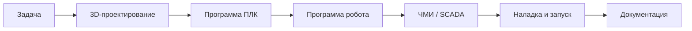

<h1 align="center">Привет, я Иван 👋</h1>
<h3 align="center">Инженер по автоматизации производства · ПЛК · Роботы · HMI/SCADA</h3>

<!-- Замените <ваш_ник> на реальный ник GitHub во всех ссылках ниже -->

<p align="center">
  <a href="https://github.com/IvanKitskanyan?tab=repositories">
    
  </a>
  
  
  
</p>

---

### 🔧 Чем занимаюсь

```text
while (смена_идёт) {
    программирую(ПЛК);          // Siemens TIA Portal, Step 7, CODESYS
    настраиваю(ЧМИ_и_SCADA);    // WinCC, панели оператора
    налаживаю(роботов);         // KUKA · JAKA · UR · Agilebot
    проектирую_в_3D();          // T-Flex, AutoCAD → STEP / DWG / PDF
}
```

---

### ⚙️ Стек

| Направление | Инструменты |
|---|---|
| **ПЛК** | TIA Portal, Step 7, CODESYS (SCL, LAD, FBD) |
| **Роботы** | KUKA (KRL), JAKA (JAKA Script), UR (URScript) |
| **HMI / SCADA** | Панели оператора Kinco , Mitsubishi |
| **CAD** | T-Flex, AutoCAD|
| **Документация** | DWG → PDF, чертежи, инструкции для операторов, Excel |

---

### 🤖 Роботы — на каком языке говорю

```krl
; KUKA KRL
DEF MAIN()
  FOR i = 1 TO 3
    PTP HOME
    LIN pick_point
    LIN place_point
  ENDFOR
END
```


---

### 📐 Как выглядит мой рабочий процесс

> Задача → Схема/3D-модель → Программа ПЛК → Программа робота → ЧМИ → Наладка на стенде → Запуск на линии → Документация



---

### 📊 Статистика

<p align="center">
  
  
</p>

<p align="center">
  
  <!-- Требуется рабочий процесс Snake: см. https://github.com/Platane/snk -->
</p>

---

### 📫 Связь

<p align="center">
  <a href="mailto:ivan.kitskanyan@gmail.com">
    
  </a>
</p>

<h4 align="center"><i>«Робот не заменит инженера — инженер запускает робота»</i></h4>
